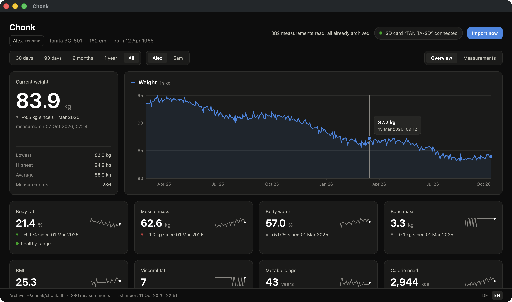

# Chonk

A desktop app (Rust + [gpui](https://www.gpui.rs)) that reads the measurements
of a Tanita body composition scale (tested with the BC-601) from its SD card,
archives them in a local SQLite database and shows them as charts.
Runs on macOS, Linux and Windows. The interface is available in English and
German.



*The screenshot shows made-up sample data.*

## Install

Ready-made packages are attached to the [releases](../../releases):

| System | Package | Note |
|---|---|---|
| macOS | `Chonk-…-macos-universal.zip` | The app is not notarized. On first launch, right-click and choose "Open", or run `xattr -dr com.apple.quarantine Chonk.app`. |
| Linux | `chonk-…-linux-x86_64.tar.gz` | Needs Vulkan and either Wayland or X11. |
| Windows | `chonk-…-windows-x86_64.zip` | Run `chonk.exe` directly. |

## Build it yourself

```sh
cargo run --release
```

On Debian/Ubuntu, run `script/linux-deps.sh` first.

## Usage

Chonk looks for the folder `TANITA/GRAPHV1` on all removable drives (macOS:
`/Volumes`, Linux: `/run/media/$USER`, `/media`, `/mnt`, Windows: every drive
letter). When the card is present, at startup or later, new measurements are
imported automatically. Measurements that are already archived are skipped,
and the card is only ever read.

On first launch the language follows your system. You can switch it in the
bottom right corner.

The scale knows eight profiles but no names. Click the profile name below the
title to give it a name of your own (Enter saves, Esc cancels).

## Data

| What | Where |
|---|---|
| Archive | `~/.chonk/chonk.db` (SQLite), on Windows `%USERPROFILE%\.chonk` |
| Measurements | Table `measurements`, unique per profile and timestamp, including the original line in `raw` |
| Profiles | Table `profiles` (slots 1–8 of the scale, custom name in `name`) |
| Settings | Table `settings` (for example the language) |
| Import log | Table `imports` |

The app used to be called "Fettsack". An existing archive in `~/.fettsack` is
moved to `~/.chonk` automatically on first launch.

Environment variables for testing: `CHONK_HOME` (a different data folder) and
`CHONK_CARD` (path to a `TANITA/GRAPHV1` folder instead of the card).

`script/fake-card.py` creates a card with made-up measurements for two
profiles:

```sh
python3 script/fake-card.py /tmp/demo/TANITA/GRAPHV1
CHONK_HOME=/tmp/demo/home CHONK_CARD=/tmp/demo/TANITA/GRAPHV1 cargo run
```

## The scale's file format

`DATA/DATAn.CSV` holds one line of key-value pairs per measurement,
`SYSTEM/PROFn.CSV` holds the profile. `n` is the profile slot.

| Key | Meaning |
|---|---|
| `MO` | Model |
| `DT`, `Ti` | Date (`DD/MM/YYYY`) and time |
| `Bt`, `GE`, `AG`, `Hm`, `AL` | Body type, gender, age, height in cm, activity level |
| `Wk`, `MI` | Weight in kg, BMI |
| `FW` | Total body fat in % |
| `Fr`, `Fl`, `FR`, `FL`, `FT` | Fat in % for right/left arm, right/left leg, trunk |
| `mW` | Total muscle mass in kg |
| `mr`, `ml`, `mR`, `mL`, `mT` | Muscle mass in kg, same segments |
| `bW` | Bone mass in kg |
| `IF` | Visceral fat level |
| `rD`, `rA` | Daily calorie need in kcal, metabolic age |
| `ww` | Body water in % |
| `CS` | Checksum: sum of all bytes before `CS` modulo 256, hexadecimal |

Lines with a wrong checksum are skipped during import.

## Development

- gpui is built with the `runtime_shaders` feature. On macOS the Xcode Command
  Line Tools are therefore enough, a full Xcode install is not needed.
- Translations live in `src/i18n.rs`. Fixed texts are fields of a struct, so
  the compiler reports missing translations.
- The `CI` workflow checks every push on Linux, macOS and Windows (formatting,
  Clippy, tests). Dependencies are cached between runs, and documentation-only
  changes do not trigger a run.
- The `Release` workflow starts when a release is published on GitHub
  (Releases → "Draft a new release" → pick a tag such as `v0.1.0` → "Publish
  release"). It builds the packages and attaches them to the release.
